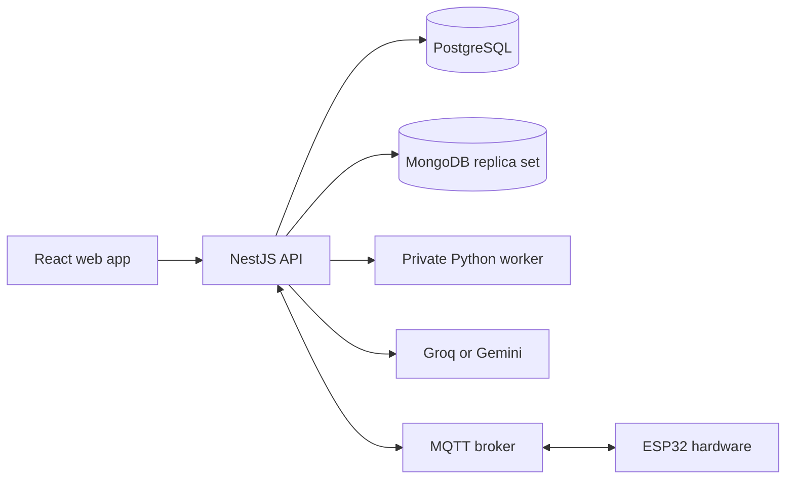

# Smart Durian Farm

A farm management platform connecting durian growers, cooperative managers and administrators with field records, ESP32 stations and AI-assisted tools.

**v1.0.0-rc.1** — verified locally; production rollout remains a separate acceptance step.

Built with **React · TypeScript · NestJS · PostgreSQL · MongoDB · MQTT · Python · YOLO11s-cls**.

## Features

- Role-based workspaces for farm owners, assigned Farmers, cooperative Managers and Admins.
- Farm and Zone management, accepted assignments, approval workflows and scope-aware resource access.
- Tree records, shared harvest batches, owner confirmation and controlled backdated corrections.
- Cultivation journals with material snapshots, a 15-minute editing window, immutable locked versions and SHA-256 verification.
- Public tree QR traceability with explicit privacy boundaries and correction history.
- Six sensor streams, telemetry retention and sequenced irrigation/spraying commands with ACK timeout and recovery.
- Private image classification history, document-grounded assistance, optional citations and explicit Groq/Gemini provider selection.

Hardware ACKs acknowledge command receipt; they do not prove physical operation. Image predictions are classification suggestions, not a definitive diagnosis. Realistic sample history remains synthetic initialization rather than evidence of field measurements.

## Architecture



The API and MQTT workers share repository instances. Persistent business data, private uploaded files and trained weights must survive application restarts. A single active controller owns actuator orchestration.

## Getting started

Requirements: Node compatible with the workspace engines, npm, Docker Compose and Python for image/PDF support. Copy `.env.example` to `.env` only on a new machine, then fill private configuration. Never overwrite an existing environment file.

```powershell
npm ci
docker compose -p smart-durian-farm up -d
npm run db:status
npm run db:migrate
npm run build
```

Run migrations only when pending; back up an existing installation first. Seed is an explicit development operation, never an automatic production startup step.

Start separate terminals:

```powershell
npm run dev:ai
npm run start:api
npm run dev:web
```

Web: `http://127.0.0.1:5173` · API: `http://127.0.0.1:3000/api` · Local API documentation: `/api/docs`.

Set up `ai/.venv` and place the separately supplied weights at `ai/models/disease/best.pt` before starting the AI worker. The [runbook](docs/RUNBOOK.md) covers Python installation, account setup, source PDFs, migrations, backup and recovery. Provider keys and private login references are intentionally absent from this repository.

## Verification

```powershell
npm run lint
npm run typecheck
npm test
npm run build
npm run lint:web
npm run typecheck:web
npm run test:web
npm run build:web
npm run test:ai
node tools/audit-data.cjs
```

Browser and database regression use isolated fixtures; follow the runbook rather than pointing them at field databases. Automated fixtures do not replace real hardware, SMS/email, provider or production acceptance.

## Documentation

| Guide | Contents |
| --- | --- |
| [Architecture](docs/ARCHITECTURE.md) | Components, business rules, authorization and known limits |
| [Runbook](docs/RUNBOOK.md) | Rebuild, local execution, realistic data, tests and recovery |
| [Deployment](docs/DEPLOYMENT.md) | Hosting choices, production blockers and release checklist |
| [MQTT protocol](docs/MQTT_PROTOCOL.md) | Final hardware-tested wire contract |

Manual API collections remain in `docs/postman/`; copy JWTs/identifiers by hand without Postman scripts. OpenAPI is generated from the running API. Previous implementation notes, thesis diagrams and unused reference assets were consolidated after a local safety archive.

## Repository layout

```text
apps/api/      API, repositories, migrations and automated tests
apps/web/      React application and browser checks
ai/            Private image/PDF worker and corpus preparation tools
assets/brand/  Brand files actually imported by the web application
deploy/        Reviewed deployment templates; no automatic deployment
docs/          Four maintained guides and manual API collections
tools/         Read-only data acceptance checks
```

Deployment is a separate, explicit operation. Review the production authentication and broker-access gates before exposing this application publicly. `.env`, private accounts, model weights, PDFs, uploaded files, test outputs and database backups must remain outside Git.
