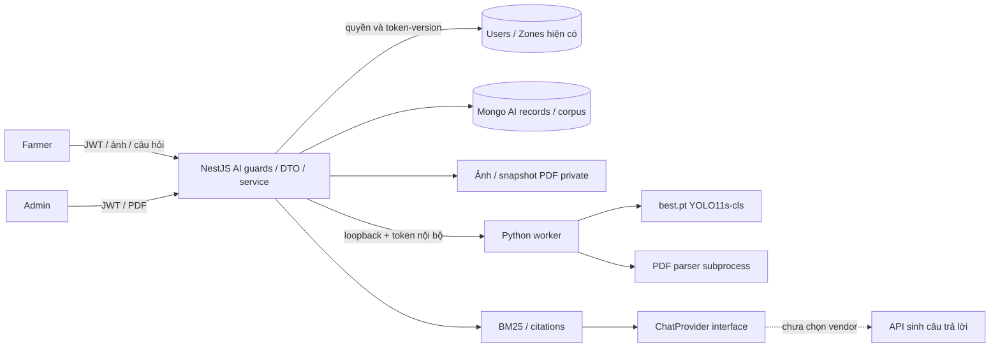

# AI backend và CSDL — bàn giao26/10/2026

Hiện hành: [AI_RAG_CORPUS_IMPLEMENTATION](AI_RAG_CORPUS_IMPLEMENTATION.md) — corpus đã nhập15 PDF, model thật, nhãn Việt/top3 và source provenance018. Các validator/backup017 ở dưới là nền tảng, không thay validator018 trong runtime mới.

Cập nhật sau khi nhận file: [AI_MODEL_AND_CORPUS_INTEGRATION](AI_MODEL_AND_CORPUS_INTEGRATION.md). best.pt đã chạy CPU, GET `/api/ai/model` kiểm tra readiness/classes thực;10 PDF đã kiểm tra nhưng chưa nhập khi phạm vi nguồn còn chờ thống nhất. Các giới hạn nghiệp vụ dưới đây giữ nguyên.

`feat/ai-foundation` từ `0965c05`. User chốt YOLO11s-cls; chat dùng API chưa chọn vendor; Farmer dùng và xem lịch sử riêng; Admin quản lý RAG; chẩn đoán độc lập được zone_id=null, chọn Zone phải có quyền. Không chỉnh nguồn ERD/MQTT/UI riêng hoặc seed kết quả AI.

## Kiến trúc



AiModule có trong memory và database AppModule. UserAccounts/ZoneRecords/DatabaseService nhận từ cùng dynamic modules/ports đã có; MongoAiStore dùng chính MongoClient/database runtime. Không tạo pool/store nghiệp vụ trùng. Python không nhận account/JWT, không ghi DB hoặc điều khiển IoT. Runner bind127.0.0.1:8001; worker token≥32 ký tự, Nest chặn URL worker ngoài loopback/credentials/redirect.

## Nghiệp vụ và quyền

- Farmer Active chẩn đoán độc lập hoặc chọn Zone; ZoneRecords.get kiểm chủ Farm/Accepted còn hiệu lực. Recheck sau inference/trước lưu, kể cả token-version. Hết phân công vẫn đọc lịch sử AI riêng, không có quyền tạo bản mới trong Zone.
- Chỉ tác giả Farmer đọc chẩn đoán/ảnh/hội thoại. Admin/Manager/chủ Farm khác không có quyền đọc riêng tư này qua API. List filter farmer_id ở store; client không gửi author/role/timestamps/predictions.
- user_feedback mặc định null=chưa đánh giá; tác giả cập nhật true/false, không thay dự đoán/model đã lưu và không tự train lại từ feedback.
- Admin import/upload, kích hoạt/ngừng dùng PDF. Nguồn Inactive không dùng cho câu hỏi mới; citations đã lưu giữ snapshot filename/hash/page/excerpt trong lịch sử riêng.
- Cặp user/assistant được append một lần bằng CAS/version; request đồng thời có thể409, tải lại trước khi gửi tiếp. Không tự retry provider/POST. Chỉ nhận used_chunk_ids thuộc context server đã truy xuất; kiểm ID không chứng minh diễn giải của LLM là đúng, cần đánh giá sau khi chọn API.
- Chưa cấu hình chat API thì messages trả503, không lưu câu trả lời giả. Không có quyền thực thi tool/điều khiển/sửa canh tác/duyệt từ chatbot; kết quả AI không tự xuất hiện trên QR.

## Migration/ERD/backup

**017_ai_foundation** chỉ Mongo; không đổi checksum001–016 hoặc13 bảng nghiệp vụ PG. Hai collection nghiệp vụ:

| Collection | Trường chính |
| --- | --- |
| AI_DISEASE_DIAGNOSTICS | ObjectId, farmer_id UUID, zone_id UUID/null theo chốt mới, image_url, ai_predictions[class_id,label,confidence], user_feedback bool/null, created_at |
| CHATBOT_CONVERSATIONS | ObjectId, farmer_id UUID, session_title, messages[role,content,citations,created_at], created_at, updated_at |

Metadata kỹ thuật cần phản ánh khi vẽ ERD: diagnosis.image_file/mime/image_sha256/model_sha256 phục vụ file private/provenance; conversation.version chống mất update. `AI_RAG_DOCUMENTS` là corpus kỹ thuật: filename/title/sha256/page_count/status/chunks/created_by/timestamps, unique PDF SHA. Đây là collection thứ ba cho RAG, không thay hai collection nghiệp vụ. Giữ nguyên file ERD của user để tự cập nhật.

Schema strict/additionalProperties=false, index author/time, unique source hash. Migration idempotent nhưng từ chối dữ liệu AI có sẵn không hợp schema, không xóa. Runtime kiểm7 Mongo collections sau017. Các archive014–016 vẫn restore đúng schema cũ;017 có ba collection AI. PG↔Mongo không có FK/transaction chung; các bước recheck không phải cam kết atomic chéo store.

JSON database không chứa binary. `db:backup` kèm `.json.assets` cho ảnh/PDF đã tham chiếu, manifest gắn database_sha256 và hash từng file; giữ cạnh JSON. Verify/restore-check xác minh cả bundle, restore-check không chạm storage vận hành. Restore-new chép file thiếu và từ chối file khác checksum. Model checkpoint và PDF inbox chưa nhập backup riêng. API cần dừng khi snapshot; lỗi bundle không được coi là backup hoàn chỉnh. Không xóa volumes để nâng schema.

## API

Bearer JWT cho `/api/ai/*`, role guard trước upload. Không gửi token nội bộ Python trong request frontend/Postman. [Collection nhập tay](postman/AI-Backend.postman_collection.json), không scripts/environment.

| Method/path sau `/api/ai` | Role | Input/kết quả |
| --- | --- | --- |
| GET `/status` | Farmer/Admin | enabled/task/declared_model/provider_configured/retrieval; không đo accuracy/readiness model |
| POST `/diagnoses` | Farmer | multipart image bắt buộc, zone_id tùy chọn/bỏ trống;201 sau inference thành công |
| GET `/diagnoses?limit=10&offset=0` và `/:id` | Farmer tác giả | Lịch sử riêng, hash/predictions/feedback; list tối đa20 |
| GET `/diagnoses/:id/image` | Farmer tác giả | Binary có auth/no-store/nosniff; frontend fetch blob bằng JWT |
| PATCH `/diagnoses/:id/feedback` | Farmer tác giả | JSON user_feedback:boolean |
| POST `/conversations` | Farmer | JSON session_title1–120, hội thoại rỗng |
| GET `/conversations` và `/:id` | Farmer tác giả | Tóm tắt/phân trang hoặc lịch sử riêng |
| POST `/conversations/:id/messages` | Farmer | JSON message1–4000; API chưa cấu hình503 |
| GET `/rag/inbox` | Admin | Tên PDF local trong ai/data/rag/pdfs, không theo symlink |
| GET `/rag/documents` | Admin | Metadata corpus, không trả cả chunks |
| POST `/rag/documents/import` | Admin | JSON filename basename trong inbox, title tùy chọn |
| POST `/rag/documents/upload` | Admin | multipart pdf, title tùy chọn |
| PATCH `/rag/documents/:id/status` | Admin | JSON status Active/Inactive |
| POST `/rag/search` | Admin | JSON message để kiểm context/citations trước nối chatbot |

Ảnh độc lập: chỉ gửi image; gắn Zone thì thêm UUID trong zone_id, không gửi literal chuỗi null. JSON ví dụ: `{"session_title":"Chăm sóc sau thu hoạch"}` rồi `{"message":"Nhận biết vấn đề ở rễ thế nào?"}`. Provider disabled không nối tin nhắn giả vào lịch sử, dù corpus đã có dữ liệu.

Lỗi401 token,403 role/khóa/thu hồi,404 không thuộc mình/không có quyền Zone,400 input/ảnh/PDF/nguồn không phù hợp,409 duplicate/CAS/nguồn đổi,413 file quá cỡ,429 rate/cap,503 worker/model/provider/busy/storage. Trường ngoài DTO bị từ chối. Query/URL không nhận tên filesystem tùy ý; ID là ObjectId24hex, ảnh lấy bằng API private.

## Giới hạn

- JPEG/PNG≤5MiB,≤16 triệu pixel; top3 hoặc ít hơn theo số lớp. Task classify, tên lớp lấy từ best.pt, score0..1 chưa phải độ chính xác đã kiểm định. Không hard-code nhãn bệnh/thuốc/threshold. Worker lazy singleton, checksum trước/sau load; thay file cần restart. [Ultralytics classification](https://docs.ultralytics.com/tasks/classify/).
- PDF≤10MiB,100 trang,400.000 ký tự,700 chunks; chunk800/overlap120. Parser subprocess25s, worker HTTP30s. Scan-only/encrypted/malformed cần xử lý trước, không OCR tự động. [pypdf](https://pypdf.readthedocs.io/en/stable/user/extract-text.html) nêu giới hạn scan/memory.
- Corpus100 tài liệu, retrieval≤5.000 chunks active/top5 contexts, BM25 từ vựng có chuẩn hóa tiếng Việt. Không gọi là vector/semantic search. Quá cap báo lỗi, không cắt/xóa âm thầm; cần chính sách archive/retention trước tăng cap.
- Hội thoại200 tin nhắn/100 cặp, admission100 hội thoại/Farmer. Rate10 ảnh/phút/Farmer,20 tạo/gửi chat/phút/Farmer,5 import/phút/Admin; hai tác vụ nặng cùng lúc, một import corpus. Một backend runtime như ràng buộc controller hiện có, chưa phải dịch vụ AI phân tán.
- File ghi thành công nhưng process bị kill trước Mongo insert có thể để lại file mồ côi; backup chỉ lấy file được tham chiếu. Không tự xóa file hay lịch sử chưa có chính sách.

## Tái lập và nghiệm thu

[ai/README](../ai/README.md) có venv/lock/model/folders/config/run/test. `.env` chỉ append key AI chưa có, token sinh ngẫu nhiên; không thay account/provider khác. AI_CHAT_PROVIDER hiện phải disabled, không cần khóa vendor khi chưa chọn. CLI bảo trì không khởi tạo Nest/SMTP/SMS/MQTT/AI inference.

Database khác: dừng API→backup→`npm run db:migrate`→backup. Local được cập nhật theo quy trình này ở checkpoint hoàn tất; không seed lại tài khoản/dữ liệu. Đưa PDF canh tác đáng tin vào inbox, Admin import/upload và dùng rag/search đối chiếu trang/đoạn trước khi dùng cho chatbot. Không tự nhập tài liệu ERD/yêu cầu phần mềm của dự án.

Colab: lưu best.pt + pip freeze/args.yaml/imgsz/nhãn; pin Ultralytics/Torch tương thích, restart worker. Đánh giá ảnh có nhãn thật, lớp hiếm, ảnh ngoài miền, top1/top3/confusion matrix; test giả không đo accuracy. Cần chốt API chat/model/key/quota và đánh giá câu trả lời/citations trước nghiệm thu chat thật. Chưa làm UI AI trong đợt backend này.

## Test/source

Checkpoint local26/10: migration017 đã Applied. Backup trước/sau có cùng2.352 dòng PostgreSQL và1.713 documents Mongo; đối chiếu toàn bộ17 bảng dữ liệu và4 collection cũ bằng nhau, chỉ thêm3 collection AI rỗng. Restore-check vào database tạm đạt checksum `5b9e156118d9c3685dd63d048c0529c14b647168283dcead78286571821a1e39`. Không seed lại hoặc chạy hardware. Backup nằm trong thư mục ignored `backups/`; dữ liệu/credentials không nằm trong tài liệu.

Backend264/264 và Python7/7 đạt;29/29 kiểm thử persistence liên quan (backup, schema nền, AI) đạt sau cập nhật hai assertion cũ từ4 sang7 collections. Browser58/58 đã đạt với module AI đăng ký; không sửa UI trong nhánh này. Lint/typecheck/build backend đạt. Kết quả inference/provider giả chỉ kiểm tra luồng và phân quyền, không chứng minh accuracy/chất lượng trả lời thật.

Lần kiểm tra persistence đầy đủ cuối cùng đạt308/308 (23 nhóm, không bỏ qua); log ignored `apps/api/.integration-dist/ai-full-persistence-final.txt`. Backend: `ai-final-backend.txt`; Python7/7. Fixture được dừng sau kiểm tra, database vận hành giữ nguyên. Các lỗi ban đầu là assertion số collection cũ; đã sửa và chạy lại đầy đủ, không thay validator để làm test qua.

Python `npm run test:ai`:7 tests với model giả/tempfile và PDF text thực, không đọc .env thật/gọi API ngoài. Chưa tải Torch/weights. TestClient có cảnh báo deprecation httpx trong framework đã khóa; không tắt cảnh báo.

Node ai.test.ts:4 nhóm image/privacy/Zone optional, corpus/Admin/provider disabled, chat CAS/nguồn sai và token-version bị thu hồi khi inference. ai.integration.ts:AppModule cùng authority PG, strict Mongo, restart/history riêng, BSON backup và sidecar ảnh/PDF restore không ghi đè. Fixture15432/27028; không dùng dữ liệu vận hành/provider/hardware thật. Fixture archive014 đã giữ bốn collection cũ, không gắn collection017 vào backup014.

```powershell
npm run test:ai
node node_modules/typescript/bin/tsc -p apps/api/tsconfig.json --outDir apps/api/.integration-dist
node --test apps/api/.integration-dist/test/ai.test.js
docker compose -p sdf-persistence-test -f docker-compose.persistence-test.yml up -d --pull never
npm run test:persistence
docker compose -p sdf-persistence-test -f docker-compose.persistence-test.yml stop
```

Source: apps/api/src/ai, ai/src, persistence/ai-schema.ts, migrations.ts, ai-assets-backup.ts, backup.ts/backup-cli.ts. [FastAPI request handling](https://fastapi.tiangolo.com/tutorial/request-files/) là tham khảo; Nest nhận multipart rồi worker nhận bytes giới hạn qua HTTP nội bộ.
