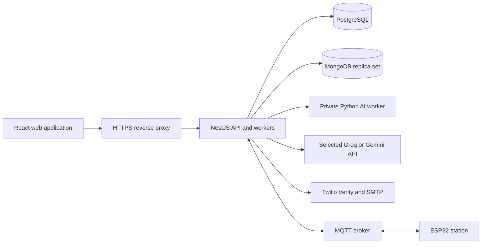

# Architecture and business rules

Maintained release reference, 16 November 2026. Source code, migrations and tests define the executable contract. The generated API specification is available at `/api/docs-json`; interactive documentation is at `/api/docs` in local development.

## Components

- `apps/web`: React, TypeScript and Vite; role-specific navigation, Vietnamese business labels, private AI history, public tree traceability. Tokens remain in the browser session, not in a shared deployment environment file.
- `apps/api`: NestJS HTTP APIs, authorization, approval workflows, shared repositories, MQTT ingestion, control orchestration, cultivation chain and AI orchestration.
- `ai`: private FastAPI image/PDF worker. YOLO11s-cls classifies images; RAG retrieval and provider calls are orchestrated by NestJS. The worker accepts only loopback connections and an internal bearer token.
- PostgreSQL contains 13 business tables plus shared technical metadata, approvals, audit and notification tables. MongoDB contains telemetry, task history, cultivation events/state, image diagnoses, conversations and RAG documents. Startup never silently falls back to RAM.
- Nest dynamic modules reuse the same account/repository/transport instances. Creating a second store for another controller is incorrect.

## Accounts and scope

Farmer registration becomes Active immediately; email is optional. Manager registration requires real email verification, remains Pending and becomes Active only after Admin approval and cooperative attachment. One Manager manages one cooperative. Admin has no public registration route. Email identities and normalized Vietnamese phone identities are unique.

Admin can create a cooperative before assigning a Manager. An unmanaged cooperative warns after seven days and becomes eligible for cleanup after 30 days; references to Farms/workflows block unsafe deletion and generate an internal notice. A Manager may change their own cooperative's name, director, address and contact number, using sequential email verification (10-minute window) then phone verification (five-minute window). Account/cooperative versions and the original verified identities are rechecked; restarting requires a new OTP verification session. Admin management and Manager attachment follow the existing approval workflow.

Owners and ordinary Farmers are both `Farmer`; ownership is evaluated per Farm. An owner can manage their own resources while holding assignments elsewhere. Manager access is restricted to their cooperative. Admin access does not bypass workflows that require owner consent. UUIDs identify resources; every private endpoint must enforce scope regardless of knowledge of the UUID.

## Land, assignments and catalogs

- Farm creation/change requires opposing Admin/owner approval. A Farm may be independent. Cooperative membership additionally needs Manager approval; leaving notifies the Manager without requiring their approval.
- Owners manage Zones, Trees, Devices, Sensors and Actuators directly. Admin proposes changes requiring owner acceptance. Managers and assigned Farmers read metadata within scope. No Tree/Device moves between Zones in v1.
- Sum of Zone areas cannot exceed Farm area, including a Farm area reduction. Newly attached standards/materials must satisfy the current Active checks.
- Assignments need recipient acceptance, use `[start_date, end_date)` and cannot overlap on a Zone. A Farmer may hold several assignments. Expiry removes work/control rights; authors retain their own cultivation history.
- Standard/material catalogs have Admin CRUD. Dosage is a number, unit and dosage basis; historical journal material snapshots are retained.

## Harvests

One Tree/date has one harvest record. A batch may include multiple Trees in the same Zone on the same harvest date: `batch_code` is deliberately not globally unique. Repeated picking is accumulated by updating an unconfirmed record. `harvest_date` is the actual date; `created_at` is backend entry time.

An owner or currently assigned accepted Farmer records harvests. Backdating beyond seven days requires a scoped Admin grant. Admin selects a Farmer by name/phone, then an owned or currently assigned Farm/Zone. The server independently rechecks authority. Manager/Admin otherwise read harvests.

Drafts can be changed; only Drafts that have never been Confirmed can be deleted. Author submission requires owner confirmation; the owner submitting their own record is auto-confirmed. Initial confirmation keeps `updated_by` and `updated_at` null. For a previously Confirmed record, a correction proposal remains Pending while approved content stays intact. The authorized independent reviewer (cooperative Manager or Admin according to scope) approves and applies it directly, restoring Confirmed and recording updater/time. A Dead/Removed Tree permits valid old harvest dates, but cannot receive a new harvest today or a correction changing its date to today; keeping its already stored date remains allowed.

## Cultivation and QR

Owners write directly; other Farmers need accepted current assignments. A current assignee can read the full Zone journal; after expiry only their own history remains available. Only the author edits/deletes a Pending event during its 15-minute window. Locked content is immutable. Corrections are new versions in the same Zone; target/activity can change. Correction rights are anchored to the original assignment and expire 15 days after that assignment ends; a newer assignment does not extend them. An owner corrects their own entries while still owning the Farm.

Watering records duration and optional volume. Spraying/Fertilizing records Active materials, quantities and unit snapshots. Outside-standard material use is recorded with a warning. Other activities contain a private work name and optional notes. Each Zone has a SHA-256 chain containing Locked Zone and Tree events in lock order. This detects tampering; it is not a blockchain. The persistence adapter verifies the full ledger and locks overdue records in bounded batches.

Public `/trace/{tree_code}` exposes whitelisted tree, Zone, cooperative, standards, Locked cultivation versions/material quantities and approved harvest contents. It hides personal information, Farm address/GPS, certificates, internal UUID fields, free text, IoT and AI. Entire Locked correction lineages remain visible with target/latest/applicability labels, including when the latest target changes to another Tree. Pending versions and unapproved harvest changes are never public.

## MQTT and control

The exact wire contract is [MQTT_PROTOCOL.md](MQTT_PROTOCOL.md). `DEVICES.id` is the internal UUID; immutable unique `station_id` is a hardware identifier, never an authentication secret. Telemetry references Device UUID plus stream ID, with `(device_id, data_stream_id)` unique in Sensor metadata. The six verified streams are 301–306. Raw units are retained. Backend arrival supplies `measured_at`; persistence supplies `received_at`. Retention is a bounded FIFO of 10,000 readings, not one reading per 15 minutes.

Actuator purposes are selected on registration and immutable. A valid Device recipe has exactly one shared pump, one watering valve and one spraying valve; capabilities are resolved from metadata, not hard-coded valve numbers. Every command, including OFF, requires Active metadata. Watering/spraying cannot run concurrently on one Device. ON opens the selected valve before the pump. OFF stops the pump before closing valves. Each step waits up to 10 seconds for its correlated ACK. ACK confirms receipt only, not physical operation. Restart/disconnect requires an acknowledged OFF reset before another Start; never replay ON. Unknown state remains Unknown when recovery cannot be acknowledged. Run one active controller instance.

A completed Stop can suggest a cultivation entry from its preceding successful session. The Farmer confirms physical work and supplies quantities/materials before saving through normal journal validation. No journal is automatically created from ACK. Reloading and explicitly recording the same session again can create a second journal; no persistent unique task-to-journal constraint exists.

## AI and provenance

Farmer-only AI histories are author-scoped. Diagnosis Zone is optional; selecting one requires current permission. Deleting a diagnosis deletes its owned record and corresponding private image; deleted chats cannot be resurrected by an in-flight append. Backup copies have their own retention policy. Admin manages RAG documents; Manager does not use Farmer AI APIs.

YOLO11s-cls provides top-three classification suggestions across ten disease classes. It has no healthy/out-of-domain class and does not prescribe spraying. Scores are model scores, not validated clinical certainty. `best.pt` and image/PDF files stay outside Git. Original PDFs are preserved; prepared durian-only documents retain hashes, original page mappings and draft labels. Chat may answer general questions without citations; cited chunks must belong to the actual retrieved, still-active source. No invented citations, live weather, tool execution or hardware control. Groq/Gemini are selected explicitly, with no automatic provider fallback or paid request retry.

## Rebuild and change discipline

Read this file, [RUNBOOK.md](RUNBOOK.md), [DEPLOYMENT.md](DEPLOYMENT.md) and the MQTT contract before changing behavior. Never edit released migration sources 001–018; add a new migration. Maintain author/scope tests and isolated integration coverage for workflow changes. Keep `.env`, database archives, model files and private acceptance accounts out of Git. Artificial historical initialization is synthetic even when its labels look realistic; never present fabricated readings as hardware measurements.
