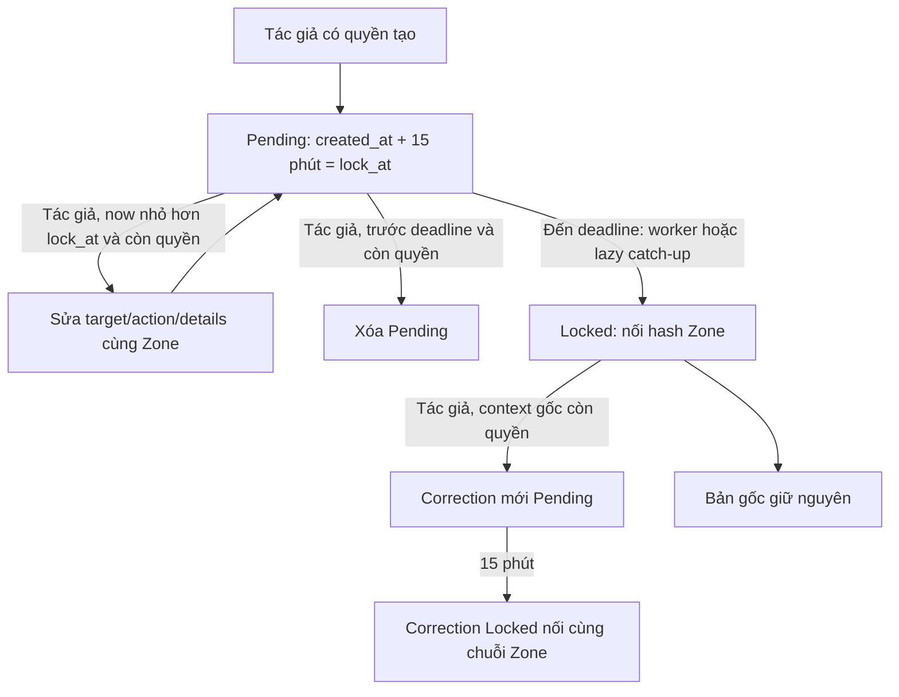

# CULTIVATION_EVENTS — quy trình đã triển khai

Ngày 2026-10-09. Nhánh **feat/cultivation-events**, base **origin/main @647e6ad** (PR#6 đã merge, tree tương đương768f3b8). Quyết định dưới đây đã được người dùng chốt; bản chuẩn bị ef00aa5 được thay bằng hướng dẫn runtime này. Đọc [API, setup và kiểm thử](CULTIVATION_EVENTS_IMPLEMENTATION.md). Không sửa ERD riêng của người dùng.

## Quyền ghi và đọc

| Vai trò/trạng thái | Tạo mới | Sửa/xóa Pending và correction | Đọc |
|---|---|---|---|
| Chủ Farm, Farmer Active | Trực tiếp, không cần tự phân công | Chỉ nhật ký chính mình; context tạo với tư cách chủ yêu cầu còn là chủ | Toàn bộ Zone của Farm |
| Farmer nhận việc, Accepted và [start,end) | Zone/cây trong Zone được giao | Chỉ tác giả; kiểm tra phân công gốc | Toàn bộ nhật ký Zone, kể cả của tác giả khác |
| Farmer đã hết phân công | Không | Chỉ tác giả trong grace của phân công gốc: now < end_date +15 ngày | Chỉ lịch sử của mình và lineage của mình |
| Manager Active | Không | Không | Farm hiện thuộc HTX mình |
| Admin Active | Không | Không | Toàn bộ |
| Tài khoản không Active | Không | Không | Không |

Correction kế thừa context gốc qua mọi thế hệ. Phân công mới hoặc thay đổi vai trò sang chủ không kéo dài grace của nhật ký tạo khi là assignee. Chủ không sửa nhật ký do Farmer khác tạo. Đọc bằng UUID/ObjectId vẫn phải qua JWT và scope; list lọc quyền trước total/pagination. Verify full Zone chain yêu cầu quyền Zone hiện tại, không suy quyền đó từ một bản ghi lịch sử riêng.

## Target và details

- Target Zone là công việc toàn Zone; Tree chỉ một cây. Cùng Zone có thể vừa tưới hàng loạt vừa phun riêng một cây.
- Cho sửa target_type/target_id/action_type khi Pending hoặc tạo correction sau Locked, **giữ cùng Zone gốc**. Không chuyển sang Zone khác ngay cả khi tác giả sở hữu cả hai. Không chuyển cây trong đợt này.
- Watering: duration_minutes bắt buộc; water_volume_l, note tùy chọn.
- Spraying/Fertilizing: materials gồm material_id + quantity, note tùy chọn. Unit và metadata lấy từ danh mục server.
- Chỉ chọn vật tư Active. Chưa gắn tiêu chuẩn Zone vẫn ghi nhận, kèm MATERIAL_OUTSIDE_STANDARD. Không tự chặn loại Fertilizer trong Spraying (ví dụ phân bón lá).
- Snapshot tiêu chuẩn + vật tư nằm trong details. Sửa danh mục/link/tiêu chuẩn sau đó không sửa lịch sử. PATCH có details là thay toàn bộ details và lấy snapshot mới; PATCH chỉ target giữ snapshot đã lưu.
- Không nhận ngày thực hiện/nhập bù hoặc giới hạn7 ngày của Harvest vào Cultivation. created_at/lock_at/locked_at do backend tạo.
- Không tự tạo nhật ký từ actuator Confirmed: ACK chỉ chứng minh nhận command.

## Lifecycle



Worker mỗi30 giây, timer unref và đóng khi Nest shutdown. Đường đọc/ghi cũng lockDue để worker chậm không kéo dài cửa sổ sửa. Quyết định thời gian dựa now<lock_at, không chỉ status. locked_at ghi thời điểm backend thật sự xử lý; lock_at giữ deadline. Không có API xác nhận/khóa/mở lại thủ công.

Chỉ một correction Pending cho mỗi root; tạo correction phải tham chiếu Locked mới nhất. Trùng request hoặc stale reference trả409, tải lại lineage. Correction mới giữ root gốc, reference trỏ bản được sửa trực tiếp. Được sửa/xóa correction Pending trong quyền của context gốc; xóa không động đến bản Locked trước. Không giới hạn số thế hệ trong cửa sổ còn quyền và dung lượng RAM.

Nội dung có hiệu lực là Locked mới nhất của root; Pending correction chưa thay thế nó. Khi correction đổi Tree/Zone target, frontend phải xét target của phiên bản có hiệu lực. API list target lọc chính xác từng document, không tự gộp Zone vào Tree hoặc tổng hợp effective history. QR/public/effective projection là đợt riêng.

## Hash-chain

Một chuỗi **mỗi Zone**, gồm mọi target Zone và Tree trong Zone. Nhóm chain không biến công việc một cây thành công việc cả Zone. Chỉ Locked tham gia, thứ tự lock_at rồi _id. Nhãn enum wire theo ERD: Pending/Locked, Zone/Tree, Watering/Spraying/Fertilizing.

Hash là SHA-256 của UTF-8 canonical JSON v1: key object sắp xếp đệ quy, array giữ thứ tự, số hữu hạn, timestamp UTC ISO. Payload gồm domain smart-durian/cultivation-events/v1 và các field document ngoại trừ hash, có previous_hash. Genesis previous_hash=null theo ERD, không dùng chuỗi64 số0. Không hash context quyền RAM. Danh sách field cố định trong cultivation-chain.ts.

Record, chain và head được ghi đồng bộ trong một process, không await giữa mutation. Verify kiểm tra trạng thái Locked, thứ tự, liên kết, hash và head(count/hash); phát hiện đổi nội dung, bỏ đầu/giữa/đuôi so với head RAM còn nguyên. Chặn tạo khi đồng hồ lùi khiến event mới đứng trước tail đã Locked.

Đây là **tamper-evident**, không phải blockchain. Kẻ có quyền viết lại toàn bộ chain và head có thể tạo lịch sử khác hợp lệ; chưa có trusted anchor ngoài hệ thống. Hash RAM không tạo audit bền vững hoặc bảo vệ nhiều worker. MongoDB transaction, concurrent lock và nơi lưu bền context phân công/head phải thiết kế riêng trước persistence.

## Field cấp gốc theo ERD

```text
_id: ObjectId (API hex24)
farmer_id: UUID
target_id: UUID
target_type: Zone | Tree
action_type: Watering | Spraying | Fertilizing
details: Object
status: Pending | Locked
is_correction: boolean
reference_event_id: ObjectId | null
root_event_id: ObjectId | null
correction_reason: text | null
created_at: timestamp
lock_at: timestamp
locked_at: timestamp | null
previous_hash: string64 | null
hash: string64 | null
```

Event thường: correction links/reason null. Pending: locked_at/hash/previous_hash null. Context ngoài document giữ zone/farm/author/assignment_id/original_created_at/root_id trong RAM; client không gửi những bằng chứng này. Chưa tạo bảng/collection/migration/seed.

## Tiếp nối session

Đọc AGENTS nếu có, git status/branch/log, handoff, guide này và implementation trước sửa. Nhánh này nhận đúng instance Auth/Farms/Zones/Trees/Assignments/Materials/Standards/StandardMaterials từ AppModule; không gọi forMock lại. Bridge.has dùng cấu hình link chung hiện có. Dung lượng10000 events toàn process, từ chối429 khi đầy, không FIFO xóa Locked.

Giữ .env, private ERD/DOCX/spec/Postman/UI; không reset/clean/stage-all. Không push/merge tự động nhánh này. Tiếp theo QR cần whitelist công khai, AI cần model/output thật, chatbot cần provider/corpus; persistence và nghiệm thu ESP32 vẫn riêng.
