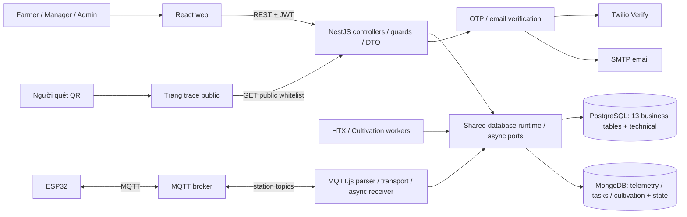
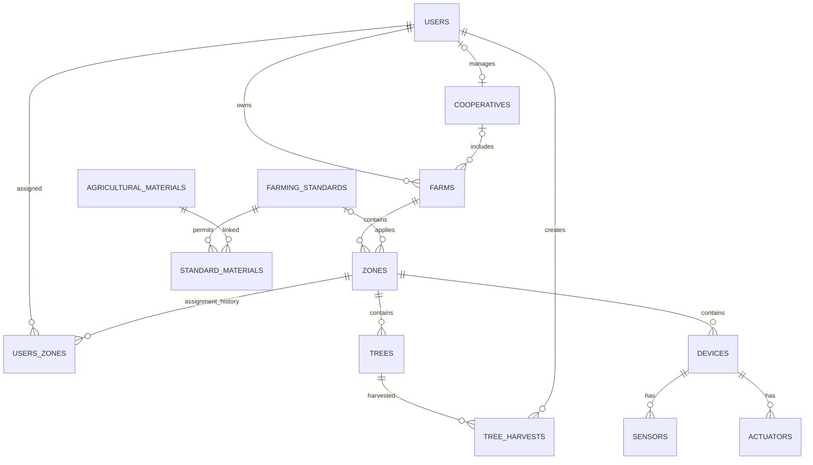
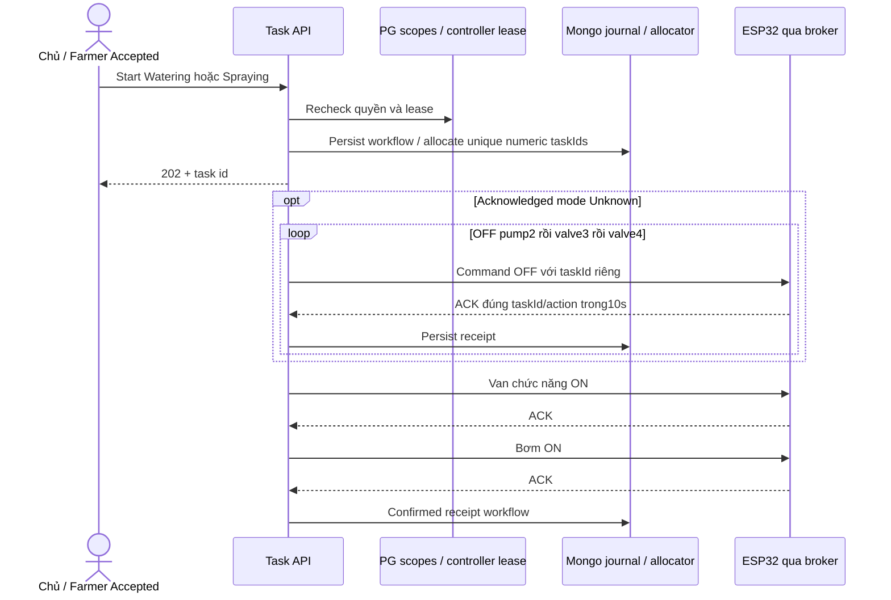

# Sơ đồ hiện hành và nguồn dùng để vẽ

Cập nhật21/10/2026, theo database runtime nền `1f6c1fd`; sơ đồ RAM/readiness-only cũ đã bị thay thế. [Source/runtime/tests](DATABASE_RUNTIME_IMPLEMENTATION.md), [nghiệp vụ](PROJECT_BUILD_SPEC.md), [tiến độ và giới hạn nghiệm thu](BACKEND_PROGRESS_CURRENT.md). Mermaid dưới đây là source chỉnh sửa được; không thay ERD người dùng, không phải bằng chứng đã test ESP32 thật.

## Kiến trúc



DB pool/client/repositories là cùng instances cho HTTP/MQTT/workers/QR. Không vẽ Android/AI như phần đã có; không có transaction chung PG/Mongo. ACK là receipt, physical_state Unknown.

## Quan hệ nghiệp vụ PostgreSQL



Sơ đồ quan hệ rút gọn, không liệt kê tất cả cột/FK. ERD đầy đủ đọc [ERD nguồn](ERD_DIAGRAM.xml), [postgres-schema.ts](../apps/api/src/persistence/postgres-schema.ts), [manifest001–014](../apps/api/src/persistence/migrations.ts) và mọi file schema được import. Manager nullable ở HTX; Farm có thể không thuộc HTX. Bảng kỹ thuật và Mongo nên vẽ riêng, không biến UUID reference qua Mongo thành FK SQL.

## Telemetry

```mermaid
sequenceDiagram
    participant ESP as ESP32
    participant B as MQTT broker
    participant R as Async receiver
    participant PG as PG metadata
    participant M as Mongo telemetry
    actor U as Người dùng
    ESP->>B: publish/station/id + sensorRecords
    B->>R: topic / payload / retained
    R->>R: Validate topic, station, payload, IDs, raw result
    R->>PG: Resolve station to Device UUID and registered Sensors
    alt Metadata/status hợp lệ
        R->>PG: Monotonic last_seen_at
        R->>M: Validate context; atomic append/counter/trim
    else Packet hoặc metadata lỗi
        R->>R: Bounded diagnostics; không tự đăng ký Sensor
    end
    U->>R: GET latest/history qua HTTP port
    R->>PG: Recheck role/scope/current assignment
    R->>M: Read with permitted interval and pagination
    M-->>U: Readings hoặc kết quả lỗi được lọc quyền
```

measured_at là backend packet arrival, received_at bước ghi; không đổi firmware. Giữ raw unit, FIFO10.000. Farmer hết phân công không có lịch sử IoT.

## Điều khiển



Sơ đồ trên chỉ happy path. Timeout/partial ACK/Stop preemption/recovery/restart xem [workflow đầy đủ](ACTUATOR_TASKS_WORKFLOW_DESIGN.md) và [journal](MONGO_ACTUATOR_TASKS_IMPLEMENTATION.md). Đủ ACK không chứng minh bơm/van vật lý đã hoạt động. Không tự ON sau restart.

## Tài nguyên vẽ thêm use case/sequence

- Use case: Users/Auth/HTX/Farm/Zone/Assignments guides; tách actor chủ Farm và Farmer nhận việc dù cùng role Farmer; thêm khách quét QR. Twilio/SMTP/ESP32 là external systems.
- Sequence nghiệp vụ: [Farm](FARMS_WORKFLOW_DESIGN.md), [Harvest](TREE_HARVESTS_WORKFLOW_DESIGN.md), [Cultivation](CULTIVATION_EVENTS_WORKFLOW_DESIGN.md), [QR](QR_TRACEABILITY_WORKFLOW_DESIGN.md), cùng controller/DTO và repository tương ứng.
- Sequence database: PG/Mongo implementation guides và integration tests cho race/rollback/restart; thể hiện alt từ chối quyền, stale version, lỗi provider/database hoặc timeout.
- Từ điển dữ liệu: schema cuối, PK/FK/nullability/enum/composite unique/check/exclusion; không UNIQUE(batch_code), stream/capability chỉ unique theo Device.

Xuất Mermaid/PlantUML source cùng SVG/PDF khi cần. Không gửi `.env`, credentials/OTP/JWT hoặc dump PII. Khi nguồn mâu thuẫn, ghi câu hỏi thay vì bịa field/luồng hoặc tự khẳng định hardware đã đạt.
