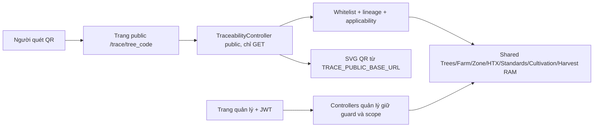

# QR traceability — quy trình đã chốt

Ngày 2026-10-10. Đã triển khai trên **feat/qr-traceability**, kế thừa **feat/cultivation-events @3ee921b** và main647e6ad. Người dùng chấp nhận **hiển thị cả chuỗi và nhãn áp dụng**. Không còn câu hỏi nghiệp vụ QR chờ trả lời. [API, cấu hình và tái lập](QR_TRACEABILITY_IMPLEMENTATION.md).

## Phạm vi công khai

Trang `/trace/{tree_code}` và bốn API chỉ đọc không cần đăng nhập. Công khai mã cây, giống/ngày trồng/trạng thái cây, tên Zone/HTX, tiêu chuẩn đang gắn, hoạt động canh tác/vật tư/lượng dùng và nội dung thu hoạch đã xác nhận. Cây Dead/Removed vẫn giữ truy xuất lịch sử; Farm độc lập không thuộc HTX.

Ẩn thông tin cá nhân Farmer, địa chỉ/GPS, số giấy chứng nhận, các field ID nội bộ, ghi chú/lý do chỉnh sửa, proposal đang chờ và toàn bộ IoT. Tiêu chuẩn đang gắn là cấu hình quản lý hiện tại, không tự tuyên bố Farm được chứng nhận. Mã cây là identifier công khai, không phải token; định dạng DRN-UUID hiện có được giữ nguyên.

## Chuỗi correction và phạm vi áp dụng

1. Catch-up nhật ký đến hạn Locked bằng cơ chế Cultivation hiện có; lấy Locked trong Zone của cây.
2. Nhóm theo root_event_id (gốc dùng _id). Dựng **đầy đủ chuỗi trước khi xét target**.
3. Chọn chuỗi nếu ít nhất một phiên bản Locked áp dụng chính cây hoặc toàn Zone của cây.
4. Công khai tất cả phiên bản Locked của chuỗi đã chọn, kể cả bản áp dụng cây khác cùng Zone. Pending không tham gia lựa chọn/đánh số/latest.
5. Mỗi bản có target, số phiên bản, latest_target, is_latest, applies_to_tree và latest_applies_to_tree. UI ghi rõ phạm vi từng bản và đánh dấu bản mới nhất.

| Chuỗi | QR cây A | QR cây B | QR cây C cùng Zone |
|---|---|---|---|
| Gốc A → correction B, đều Locked | Cả2 bản; hiện tại áp dụng B, không áp dụng A | Cả2 bản; hiện tại áp dụng B | Không hiện chuỗi này |
| Gốc A → B; correction C còn Pending | Giống hàng trên | Giống hàng trên | Chưa hiện chuỗi này |
| Gốc A → B → toàn Zone, cả3 Locked | Cả3 bản; hiện tại toàn Zone | Cả3 bản; hiện tại toàn Zone | Cả3 bản; hiện tại toàn Zone |

Chuỗi sắp theo bản Locked mới nhất giảm dần; trong chuỗi sắp gốc → correction. Phân trang tính trên **phiên bản**, mặc định20/tối đa100, offset tối đa100000. Một trang có thể cắt giữa chuỗi; từng dòng vẫn chứa số/target mới nhất để không nhận nhầm bản cũ là hiện tại. history_key là SHA-256 dùng nhóm public, không trả ObjectId hoặc toàn hash-chain. Không công khai API verify/private chain và không gọi cơ chế này là blockchain.

Snapshot vật tư/đơn vị/tiêu chuẩn giữ theo lúc nhập. Vật tư ngoài tiêu chuẩn có nhãn standard_linked=false, không serialize raw warnings chứa UUID. Cultivation chỉ có thời gian **nhập hệ thống** và khóa, không tự đổi thành ngày thực hiện. Không suy hoạt động canh tác thực tế từ receipt ACK.

## Thu hoạch

Draft và Pending xác nhận lần đầu không public. Đã từng Confirmed thì public nội dung được duyệt đang lưu trong record. Khi correction Pending, record giữ nội dung cũ; proposed_changes giữ riêng và không public. Duyệt đúng rule Manager HTX/Admin Farm độc lập thì projection đổi; từ chối thì giữ cũ. confirmation_state=Confirmed mô tả nội dung được duyệt, không sao chép status Pending của workflow private. Ngày thu hoạch thực tế dùng harvest_date.

## Kiến trúc và giới hạn

Không thêm bảng QR/store riêng/migration/seed. AppModule tái dùng đúng dynamic-module instances, không đăng ký store trùng. JSON/SVG có Cache-Control:no-store và X-Content-Type-Options:nosniff. Base URL lấy từ cấu hình, không từ Host/forwarded headers hoặc input người quét. Public page nằm ngoài AuthProvider và không gửi JWT.

RAM mất khi backend restart, mã cây demo mất theo dữ liệu. Chưa nghiệm thu điện thoại/camera vật lý hoặc domain public. Lưu bền, frontend nhập nhật ký/control, AI/chatbot và hardware acceptance là các đợt riêng. Không tự push/merge QR; giữ các file riêng ngoài commit.
